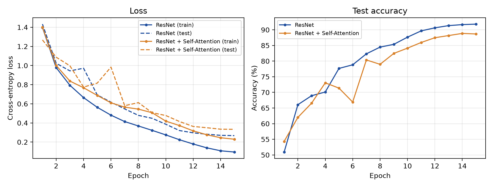

# CIFAR-10：ResNet 与 ResNet + 自注意力

在 CIFAR-10 上从头训练一个带残差连接的小型卷积网络，并在其顶部加入自注意力层，比较两者的训练过程与测试集表现。



## 结果

| 模型 | 参数量 | 测试准确率 | 测试损失 | 训练用时（15 轮） |
|---|---|---|---|---|
| ResNet | 2.78M | **91.82%** | 0.267 | 8.9 min |
| ResNet + 自注意力 | 3.85M | **88.67%** | 0.333 | 11.1 min |

- 每轮的训练/测试损失与准确率：[`results/history_resnet.json`](results/history_resnet.json)、[`results/history_resnet_attn.json`](results/history_resnet_attn.json)
- 原始训练日志与权重评估输出：[`results/logs/`](results/logs/)
- 训练好的权重：[`checkpoints/`](checkpoints/)

实验环境：Apple M5 Pro（PyTorch MPS 后端），PyTorch 2.14.1，随机种子 0。同一代码先后完整运行两次，15 轮的每项指标逐一相同；用保存的权重重新评估，测试准确率与训练日志一致。

## 模型

**ResNet**（`ResNet`，`train.py`）

```
3×32×32 → Conv3×3(64) + BN + ReLU
        → Stage1: 2 × BasicBlock(64)          32×32
        → Stage2: 2 × BasicBlock(128), 步长 2  16×16
        → Stage3: 2 × BasicBlock(256), 步长 2   8×8
        → 全局平均池化 → Linear(256 → 10)
```

每个 `BasicBlock` 为两层 3×3 卷积（各带 BN），输出 `ReLU(F(x) + shortcut(x))`；尺寸或通道变化时 shortcut 为 1×1 卷积，否则为恒等映射。

**ResNet + 自注意力**（`ResNetAttn`）

在 Stage3 之后把 256×8×8 特征图展开为 64 个 256 维向量，加上可学习的位置编码，经过 2 个 Pre-Norm Transformer 编码器块（4 头多头自注意力 + MLP 256→512→256，GELU，均带残差），再经 LayerNorm、对 64 个位置取平均后分类。

## 训练设置

| 项目 | 设置 |
|---|---|
| 数据增强 | RandomCrop(32, padding=4)、RandomHorizontalFlip、按通道标准化 |
| 优化器 | AdamW，权重衰减 5e-4 |
| 学习率 | OneCycle，最大 3e-3（约第 4.5 轮达到峰值） |
| Batch size / 轮数 | 128 / 15 |

## 分析

加入自注意力后测试准确率下降约 3 个百分点，且**训练集**上的损失也明显更高（0.230 vs 0.096），说明主要是优化不充分（欠拟合），而非过拟合：

1. **归纳偏置**：卷积自带局部性与平移等变性，适合小图像；自注意力需要从数据中学习位置关系，在 CIFAR-10 这样的小数据集上更难训练。
2. **训练量不足**：新增约 107 万参数从随机初始化开始，15 轮不足以让注意力层充分收敛。
3. **额外收益有限**：Stage3 的理论感受野约 53×53，已覆盖整张 32×32 图像，在 8×8 特征图上做全局交互能补充的信息不多。

注意力模型在第 5–8 轮测试准确率波动明显（71% → 67% → 80% → 79%），与 OneCycle 学习率在约第 4.5 轮达到峰值的时间吻合；学习率回落后曲线趋于平稳。

以上结论来自单个随机种子，未做多种子重复。

## 复现

```bash
pip install -r requirements.txt

# 训练（首次运行自动下载 CIFAR-10 到 data/），权重存到 checkpoints/，记录存到 results/
python train.py --model resnet
python train.py --model resnet_attn

# 用已保存的权重在测试集上评估
python eval.py --model resnet        # 91.82%
python eval.py --model resnet_attn   # 88.67%
```

有 NVIDIA GPU 时自动使用 CUDA，否则依次尝试 MPS、CPU。
